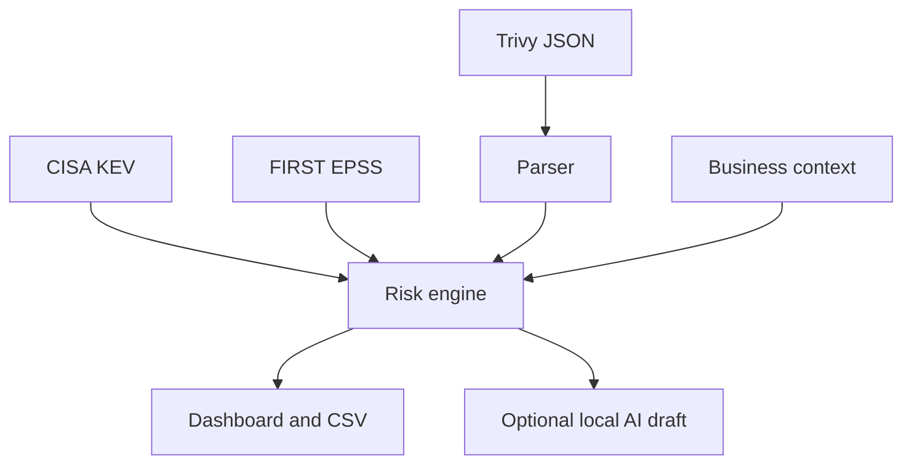

# AegisRisk AI
Local vulnerability intelligence and remediation prioritization prototype.

## Quick start
```bash
uv sync --python 3.12
uv run python -m pytest -q
uv run ruff check .
uv run streamlit run app.py --server.address 127.0.0.1
```
Open http://localhost:8501. Start with Offline synthetic demo. No AI or internet is required after dependency installation. Optional: run Ollama locally and `ollama pull qwen3:4b`.

## Real scan
Use a trusted Trivy release from https://github.com/aquasecurity/trivy/releases. For example: `trivy image --scanners vuln --format json -o data/trivy-results.json python:3.12-slim`. Upload the JSON, confirm asset context, and opt into public intelligence enrichment. Do not publish private scan reports.

## Architecture


## Risk policy
KEV 35 points, EPSS 25, CVSS 15, criticality 15, internet exposure 10. Known exploitation plus internet exposure forces P1. Other known exploited findings are at least P2. Missing inputs give an incomplete score, never a zero substitute. This is a custom demonstration policy, not validated loss probability or an official standard.

## Evidence
Add your own screenshots under `docs/screenshots/` after running the lab: tests, demo dashboard, Trivy scan, enriched queue, AI draft, CI. Do not share secrets or actual private assets.

## Limitations
One scanned artifact per upload; asset context is manual and scan-wide. Only CVE identifiers and CVSS v3 scores are processed. Maximum 500 findings. Demo scores and KEV flags are illustrative. No persistent inventory, authentication, automated remediation or production deployment. AI outputs are untrusted drafts. Public EPSS lookup transmits CVE IDs. External availability is not guaranteed. Dependency ranges are not a lockfile; generate and commit uv.lock locally.

## Sources
- https://github.com/aquasecurity/trivy
- https://github.com/CISAGov/kev-data
- https://www.first.org/epss/api
- https://www.first.org/cvss/
- https://docs.ollama.com/api
- https://docs.streamlit.io/
- https://docs.astral.sh/uv/
- https://docs.github.com/en/actions
