# AegisRisk AI

### AI-Assisted Cyber Exposure Management & Vulnerability Prioritization

    [](https://github.com/Faizefied393/AegisRisk-AI/actions/workflows/ci.yml)

A security engineering portfolio prototype that combines real container vulnerability findings, public exploitation intelligence and simulated business context to help analysts decide **which vulnerabilities to address first and why**. A local language model assists with remediation guidance without controlling risk scores or executing changes.

## Business problem

Security teams cannot remediate every vulnerability immediately. Technical severity alone does not capture documented exploitation, exploitation likelihood, asset importance or exposure. AegisRisk AI brings these signals together in a transparent remediation queue for analyst review.

| Business need | Implemented capability |
|---|---|
| Prioritize limited security resources | Explainable risk scoring and KEV overrides |
| Reduce manual intelligence correlation | CISA KEV and FIRST EPSS integration |
| Identify vulnerable dependencies | Trivy JSON ingestion and deduplication |
| Support analysts and management | Searchable dashboard and CSV risk register |
| Use AI without giving it operational authority | Local advisory model and deterministic fallback |
| Maintain reliable software | Pytest, Ruff and GitHub Actions |

## Application demonstration

### Risk dashboard — offline synthetic scenario

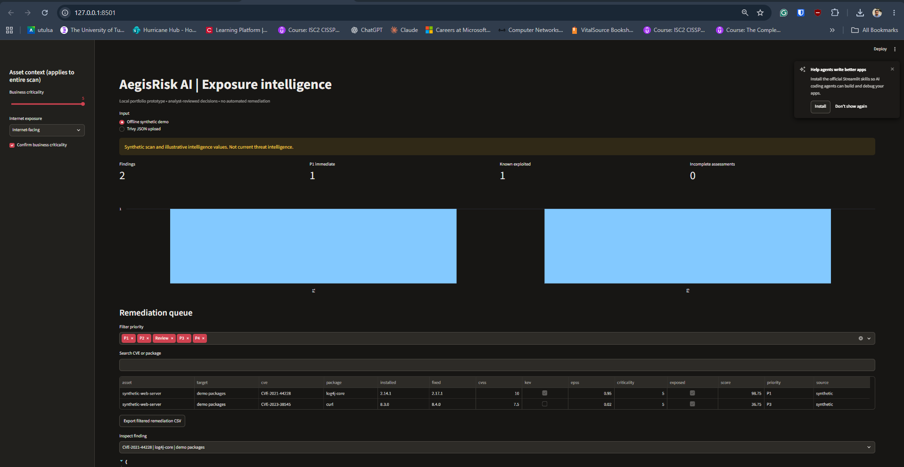

### Finding-level review

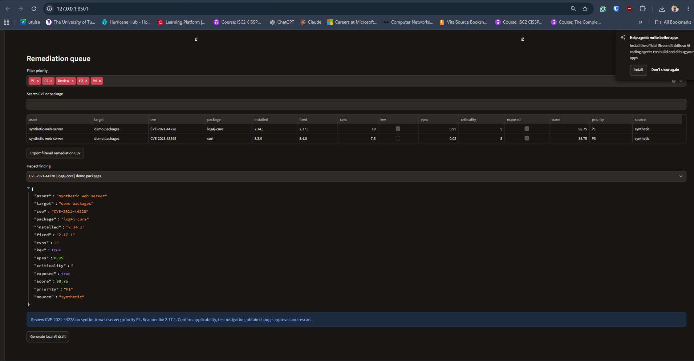

## Architecture

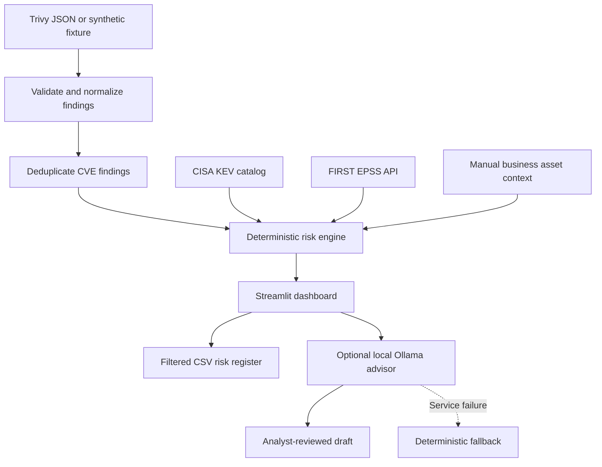

**Trust boundary:** external scan records and AI responses are untrusted. The model has no execution tools and cannot change the independently computed priority. Human review and change approval are required before remediation.

## Technology stack

| Layer | Technology |
|---|---|
| Development | WSL2, VS Code, Git, Python 3.12, uv |
| Vulnerability discovery | Docker, Trivy |
| Threat intelligence | CISA KEV, FIRST EPSS, CVSS v3 |
| Application and analytics | Streamlit, Pandas, Requests |
| Local AI | Ollama, Qwen3 4B |
| Quality and CI | Pytest, Ruff, GitHub Actions |
| Secret scanning exercise | Gitleaks |

## Explainable risk policy

| Signal | Weight | Purpose |
|---|---:|---|
| CISA KEV membership | 35 | Documented exploitation |
| EPSS probability | 25 | Estimated exploitation in the next 30 days |
| CVSS severity | 15 | Technical severity |
| Business criticality | 15 | Importance of the asset |
| Internet exposure | 10 | External accessibility |

```text
Score = 35 × KEV + 25 × EPSS + 1.5 × CVSS
        + 3 × Criticality + 10 × InternetExposure
```

KEV and exposure are Boolean inputs; EPSS ranges from 0 to 1, CVSS from 0 to 10 and criticality from 1 to 5.

| Priority | Decision rule (evaluated in order) |
|---|---|
| P1 | KEV and internet-facing, or complete score ≥ 80 |
| P2 | Other KEV finding, or complete score ≥ 60 |
| Review | Required inputs missing or invalid, with no KEV override |
| P3 | Complete score ≥ 35 |
| P4 | Remaining complete scores |

Missing inputs prevent calculation of a complete numerical score; known exploitation overrides still apply. This is a custom demonstration policy, not an official standard, calibrated loss estimate or probability of organizational compromise.

### Risk engine implementation

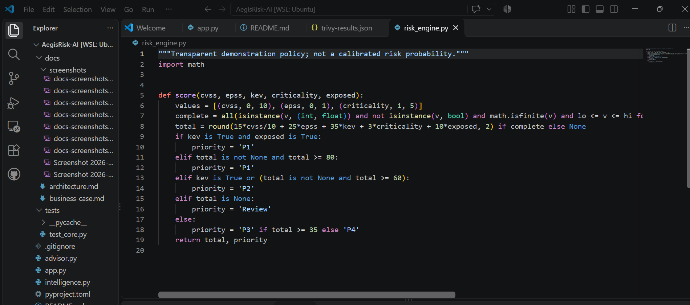

## Run locally

Prerequisites: Git, uv and Python 3.12. Docker is required for the example scanner workflow; Ollama is optional.

```bash
git clone https://github.com/Faizefied393/AegisRisk-AI.git
cd AegisRisk-AI
uv sync --locked --python 3.12
uv run python -m pytest -v
uv run ruff check .
uv run streamlit run app.py --server.address 127.0.0.1
```

Open [http://localhost:8501](http://localhost:8501) and select **Offline synthetic demo**. Once dependencies are installed, this mode requires neither an external intelligence feed nor an AI server. Demo intelligence values are illustrative and not current observations.

<details>
<summary>Development environment verification</summary>

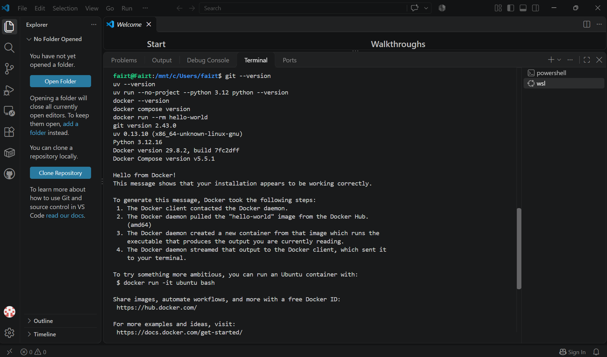

</details>

### Scan a real container image

Use a trusted Trivy release or pinned image digest. The following is a convenient lab example:

```bash
docker run --rm \
  -v trivy-cache:/root/.cache/trivy \
  aquasec/trivy:latest image \
  --scanners vuln --format json \
  python:3.12-slim > data/trivy-results.json

uv run python -m json.tool data/trivy-results.json > /dev/null
```

Upload the JSON in **Trivy JSON upload**, confirm the simulated business context, and opt into public KEV and EPSS enrichment. Only CVE identifiers are transmitted to FIRST for enrichment. Do not publish private scan reports.

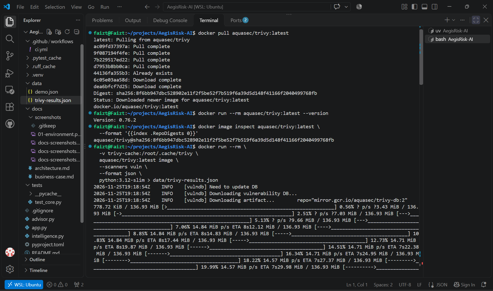

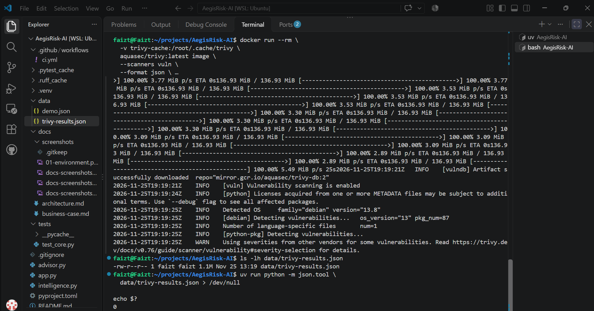

### Uploaded scan and threat intelligence

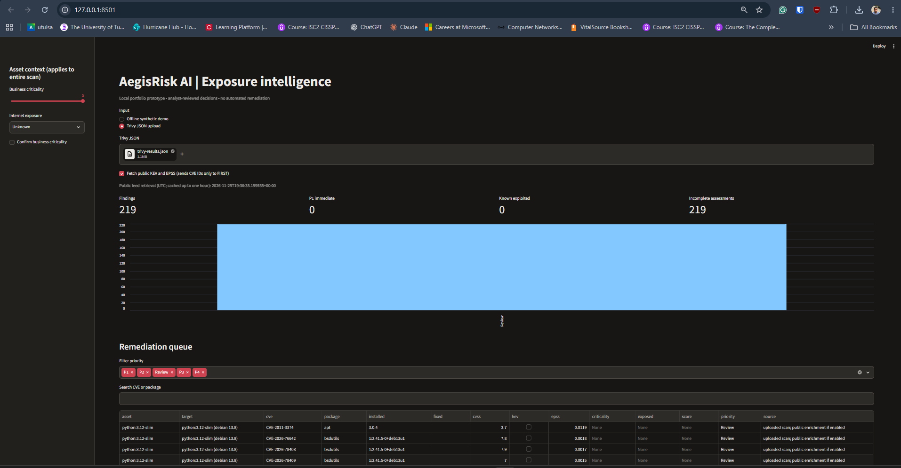

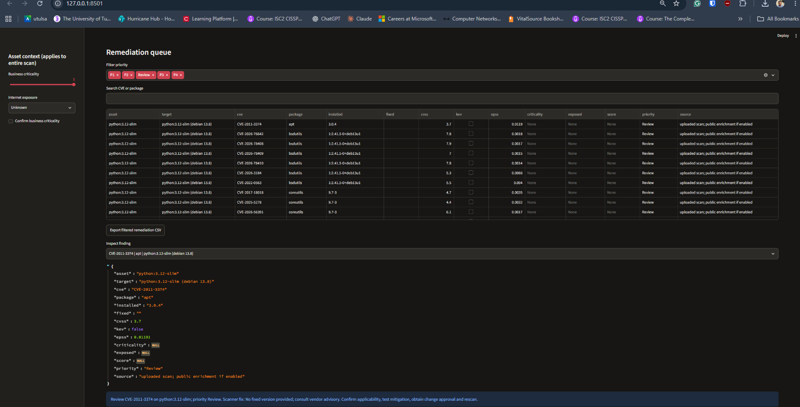

### Enable local AI (optional)

Install [Ollama](https://ollama.com/download), start its local service if needed, then run:

```bash
ollama pull qwen3:4b
curl http://127.0.0.1:11434/api/tags
```

Select a finding and click **Generate local AI draft**. Validate all recommendations against vendor guidance. If inference fails, the deterministic fallback remains available.


*Local inference demonstration; this is not evidence of validated remediation accuracy.*

## Security and reliability

- Deterministic prioritization independent of model output.
- Explicit unavailable intelligence states, request timeouts and EPSS batches of up to 50 identifiers.
- Public intelligence responses cached in the dashboard for up to one hour, with retrieval timestamps.
- Malformed JSON handling and duplicate finding removal.
- CSV mitigation for common spreadsheet formula prefixes.
- Loopback-only recommended dashboard startup and local AI endpoint.
- No automated patching, shell execution or AI tool permissions.
- Committed `uv.lock` for reproducible local dependencies; the existing CI workflow installs dependency ranges.

### Automated verification

Seven core tests cover scoring, missing inputs, demonstration parsing, deduplication, invalid input and simulated network/AI failures. Run the commands above to reproduce the tests. The workflow badge reflects GitHub Actions status; the tests do not establish comprehensive security or production readiness.

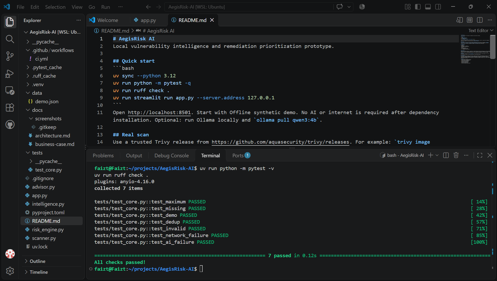

### Input validation evidence

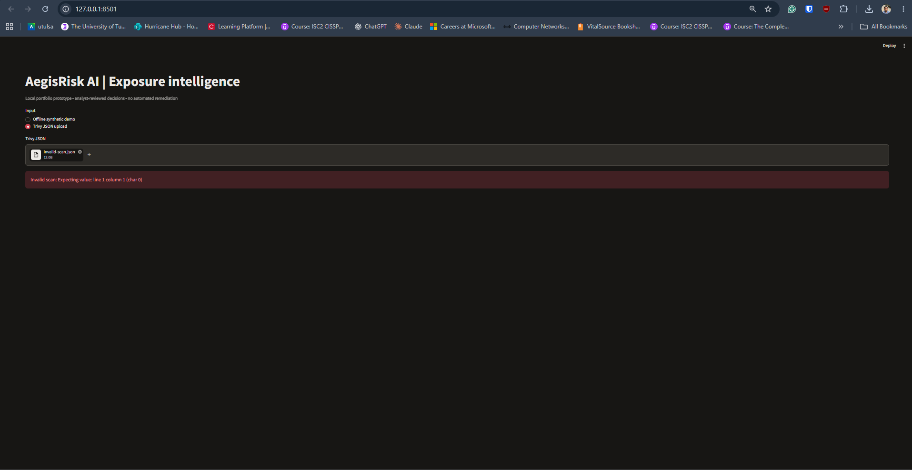

### Secret scanning exercise

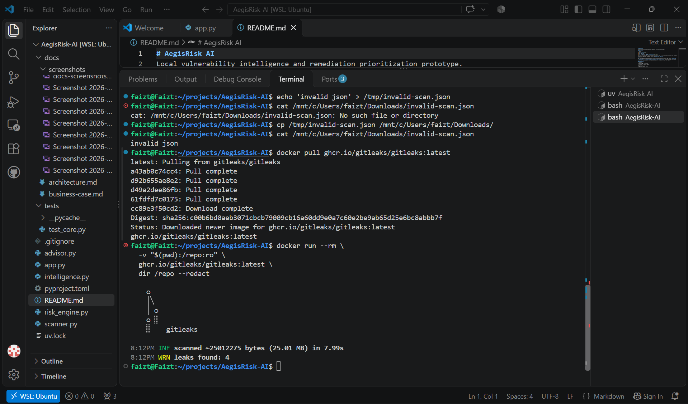

## Enterprise applications

| Industry | Potential application |
|---|---|
| Financial services | Prioritize vulnerabilities affecting critical business services and sensitive data |
| Oil, gas and energy | Support IT vulnerability prioritization while recognizing operational maintenance constraints |
| Government and defense | Use documented exploitation intelligence and repeatable risk decisions |
| Technology and cloud | Evaluate container dependencies and support DevSecOps workflows |
| AI and cybersecurity companies | Explore bounded AI assistance and security automation |

These are potential use cases, not deployments or regulatory compliance claims. OT security requires additional safety, availability and asset-specific controls.

## Business reporting and illustrative value

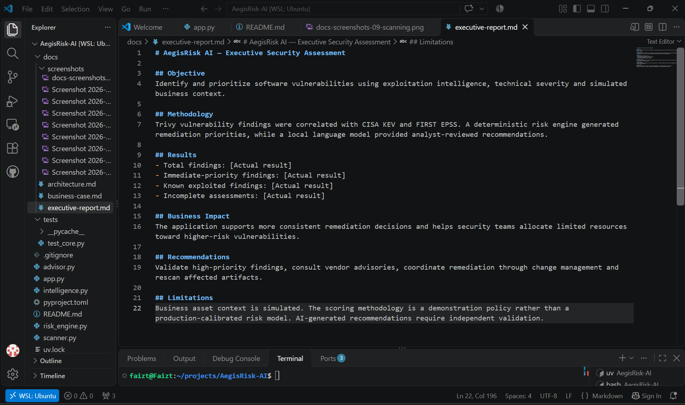

*Executive report template, not a completed assessment or exported CSV.*

<details>
<summary>Illustrative business value calculator</summary>

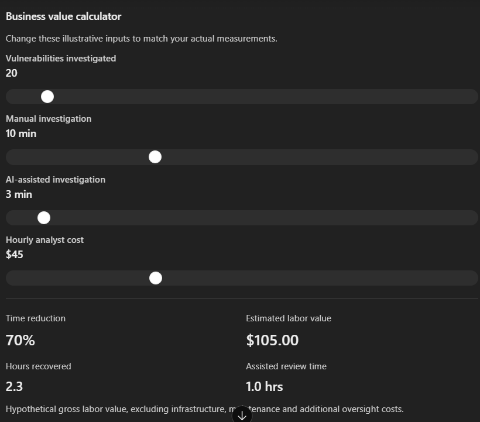

*Illustrative calculation only; these figures are not measured savings or an implemented dashboard feature.*

</details>

## Repository structure

```text
AegisRisk-AI/
├── app.py                 # Dashboard and orchestration
├── scanner.py             # Trivy parser and deduplication
├── intelligence.py        # KEV and EPSS retrieval
├── risk_engine.py         # Deterministic risk policy
├── advisor.py             # Local AI and fallback
├── data/demo.json         # Synthetic fixture
├── tests/test_core.py     # Automated core tests
├── docs/                  # Architecture, business case and evidence
├── .github/workflows/ci.yml
├── pyproject.toml
└── uv.lock
```

## Documentation and limitations

- [Architecture](docs/architecture.md)
- [Business case](docs/business-case.md)
- [Executive assessment template](docs/executive-report.md)
- [Home-lab screenshots](docs/screenshots/)

This is a single-user portfolio prototype with scan-wide manual asset context, CVE-only processing, CVSS v3 extraction and a 500-finding processing limit in the UI. It does not provide persistent asset inventory, authentication, a remediation ticket lifecycle, automated patching or independent verification of AI claims. Executive report measurements remain to be populated from verified results. No labor savings or risk reduction are claimed without measurement.

### Future work

1. Before-and-after scan comparison and remediation verification.
2. Persistent per-asset inventory, ownership and remediation tracking.
3. Structured AI outputs and adversarial evaluation.
4. Stronger intelligence provenance and locked CI dependencies.
5. SBOM integration and industry-specific policy profiles.

## Official references

- [Trivy](https://github.com/aquasecurity/trivy) · [CISA KEV catalog](https://www.cisa.gov/known-exploited-vulnerabilities-catalog) · [KEV data repository](https://github.com/CISAGov/kev-data)
- [FIRST EPSS API](https://www.first.org/epss/api) · [FIRST CVSS](https://www.first.org/cvss/)
- [Ollama API](https://docs.ollama.com/api) · [Qwen3](https://ollama.com/library/qwen3) · [Streamlit](https://docs.streamlit.io/)
- [uv](https://docs.astral.sh/uv/) · [Pytest](https://docs.pytest.org/) · [Ruff](https://docs.astral.sh/ruff/) · [GitHub Actions](https://docs.github.com/en/actions) · [Gitleaks](https://github.com/gitleaks/gitleaks)
- Further reading: [NIST enterprise patch management](https://csrc.nist.gov/pubs/sp/800/40/r4/final) · [NIST AI RMF](https://www.nist.gov/itl/ai-risk-management-framework) · [OWASP GenAI Security](https://genai.owasp.org/)
